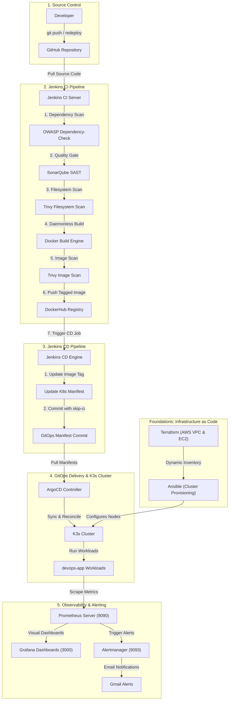

# Complete Enterprise DevSecOps & GitOps Platform

A production-grade, fault-tolerant DevSecOps platform that takes a containerized Express.js microservice through the full deployment and observability lifecycle — powered by **Terraform**, **Ansible**, **K3s Kubernetes**, **ArgoCD**, **Jenkins**, **SonarQube**, **OWASP**, **Trivy**, **Prometheus**, and **Grafana**.

---

## 🏛️ Architecture Overview

The system architecture follows a decoupled **Shift-Left DevSecOps** and **Declarative GitOps** model:



### ASCII Architecture Flow

```text
[Developer]
    │
    ▼ (git push / make redeploy)
[GitHub Repository]
    │
    ▼ (Pull Code)
[Jenkins CI Job: devops-ci-pipeline]
    │ ──► 1. OWASP Dependency-Check (CVE Analysis)
    │ ──► 2. SonarQube SAST & Quality Gate
    │ ──► 3. Trivy Filesystem & Secrets Scan
    │ ──► 4. Buildah Rootless Docker Build & /health Verification
    │ ──► 5. Trivy Container Image Scan
    │ ──► 6. Push Image to DockerHub (tag: ${BUILD_NUMBER} & latest)
    │
    ▼ (Trigger CD Job upon CI Success)
[Jenkins CD Job: devops-cd-pipeline]
    │ ──► 1. Update devops_tools/k8s/deployment.yaml image tag
    │ ──► 2. Commit & Push to GitHub with [skip ci]
    │
    ▼ (GitOps Watch & Auto-Reconcile)
[ArgoCD Controller]
    │
    ▼ (Deploy & Rolling Update)
[K3s Kubernetes Cluster] ──► Pods: devops-app
    │
    ▼ (Metrics Scraping & Observability)
[Prometheus (9090)] ──► [Grafana Dashboards (3000)]
    │
    ▼ (Downtime / Crash Alert Routing)
[Alertmanager (9093)] ──► [Gmail / SMTP Email Alerts]
```

---

## 🛠️ Complete Tech Stack

| Domain | Tool | Purpose | Directory / Configuration |
| :--- | :--- | :--- | :--- |
| **Infrastructure as Code** | **Terraform** | AWS VPC, Subnets, Internet Gateways, Security Groups, and EC2 nodes | `devops_tools/terraform/` |
| **Configuration Management** | **Ansible** | OS hardening, dynamic inventory, multi-node K3s setup, and monitoring deploy | `devops_tools/ansible/` |
| **Container Engine** | **Docker & Buildah** | Local service composition and daemonless container builds | `Dockerfile`, `docker-compose.yml` |
| **Continuous Integration** | **Jenkins** | Automated CI pipeline with JCasC init scripts (`init.groovy.d/`) | `devops_tools/jenkins/Jenkinsfile.ci` |
| **Code Quality & SAST** | **SonarQube** | Static code analysis, security hotspots, and quality gates | `sonar-project.properties` |
| **Dependency Scanning** | **OWASP Dependency-Check**| Scans application dependencies for known CVEs | Integrated in CI pipeline |
| **Vulnerability Scanning** | **Trivy** | Filesystem vulnerability/secret scan & container image scan | Integrated in CI pipeline |
| **Container Registry** | **DockerHub** | Production container registry storage | `docker.io/<username>/devops-app` |
| **Continuous Delivery** | **Jenkins CD Job** | Automated manifest version update and commit with `[skip ci]` | `devops_tools/jenkins/Jenkinsfile.cd` |
| **GitOps Engine** | **ArgoCD** | Declarative synchronization and self-healing deployment to K8s | `devops_tools/argocd/` |
| **Container Orchestration** | **K3s (Kubernetes)** | Highly available, lightweight Kubernetes cluster running app workloads | `devops_tools/k8s/` |
| **Metrics Collection** | **Prometheus** | Cluster, node, and microservice metric scraping | `devops_tools/k8s/monitoring/prometheus.yaml` |
| **Visualization** | **Grafana** | Real-time monitoring dashboards (auto-provisioned Prometheus datasource)| `devops_tools/k8s/monitoring/grafana.yaml` |
| **Alerting & Notifications**| **Alertmanager** | Pod crash and downtime email notifications via Gmail SMTP | `devops_tools/k8s/monitoring/alertmanager.yaml` |
| **Database** | **MongoDB Atlas** | Fully managed NoSQL cloud database injected via Kubernetes secret | `db.js`, `devops_tools/k8s/secret.yaml` |

---

## 📋 Prerequisites Checklist

Before running the deployment, ensure the following are installed and configured:

### 1. CLI Tools
* **Docker & Docker Compose v2+**: `sudo apt install -y docker.io docker-compose-v2`
* **Terraform v1.5+**: `sudo apt install -y terraform`
* **Ansible v2.14+**: `sudo apt install -y ansible`
* **Core Utilities**: `sudo apt install -y openssh-client jq curl`
* **kubectl** *(optional for local management)*: Kubernetes CLI

### 2. AWS Credentials
Export your AWS access credentials:
```bash
export AWS_ACCESS_KEY_ID="AKIAxxxxxxxxxxxxxxxx"
export AWS_SECRET_ACCESS_KEY="wJalrXUtnFEMI/K7MDENG/bPxRfiCYEXAMPLEKEY"
export AWS_DEFAULT_REGION="ap-south-1"
```

### 3. SSH Key Pair
Create an RSA key pair in AWS EC2 named `devops-key` (or your choice). Save the `.pem` file to `~/.ssh/` and restrict permissions:
```bash
chmod 400 ~/.ssh/devops-key.pem
```

### 4. Configuration Files (3 Files)

#### A. Configure Terraform (`devops_tools/terraform/terraform.tfvars`)
```bash
cp devops_tools/terraform/terraform.tfvars.example devops_tools/terraform/terraform.tfvars
```
Update:
```hcl
aws_region         = "ap-south-1"
project_name       = "devops-project"
environment        = "dev"
key_pair_name      = "devops-key"                  # Exact name of AWS Key Pair
allowed_ssh_cidr   = "0.0.0.0/0"                   # Or "YOUR_IP/32"
dockerhub_username = "your-dockerhub-username"
```

#### B. Configure Jenkins & SonarQube (`devops_tools/jenkins/.env`)
```bash
cp devops_tools/jenkins/.env.example devops_tools/jenkins/.env
```
Update:
```env
JENKINS_IMAGE=jenkins-img:lts
JENKINS_SECRET=your-jenkins-agent-secret-here
JENKINS_ADMIN_USER=admin
JENKINS_ADMIN_PASSWORD=admin123
DOCKERHUB_USERNAME=your-dockerhub-username
DOCKERHUB_PASSWORD=your-dockerhub-token
SONARQUBE_URL=http://sonarqube:9000
SONAR_TOKEN=your-sonarqube-token-here
```

#### C. Configure Application & Database (Root `.env`)
```bash
cp .env.example .env
```
Update:
```env
PORT=4444
NODE_ENV=production
MONGO_URI=mongodb+srv://<username>:<password>@cluster0.abcde.mongodb.net/devops_prod?retryWrites=true&w=majority
```

---

## ⚡ Unified CLI Commands (Makefile & Orchestrator)

All operations are automated through the root [Makefile](file:///home/ashish/Original/Drive%20(B)/DevOps/04_Docker/deployment/codes/Makefile) and [orchestrate.sh](file:///home/ashish/Original/Drive%20(B)/DevOps/04_Docker/deployment/codes/orchestrate.sh):

```bash
# ───────────────── 🚀 Full Deploy & Redeploy ─────────────────
make deploy                 # Full end-to-end deployment with automated rollback on error
make redeploy               # Fast redeploy: commits changes, pushes to Git, and triggers CI/CD
make redeploy MSG="new fix" # Redeploy with custom git commit message

# ───────────────── 🔄 Manual Pipeline Triggers ─────────────────
make trigger-ci             # Trigger Jenkins CI pipeline via REST API
make trigger-ci PUSH=true   # Commit & push local changes first, then trigger CI
make trigger-cd TAG=12      # Trigger Jenkins CD pipeline for a specific Docker image tag

# ───────────────── 🔍 Status & Validation ─────────────────────
make deploy-status          # Inspect live status of cloud nodes, containers, and pipelines
make deploy-plan            # Run preflight validation and display Terraform execution plan

# ───────────────── 📊 Observability & Port Forwarding ─────────
make monitoring-port-forward# Forwards Grafana (3000) and Prometheus (9090) to localhost
make sonar-logs             # Tail live logs for SonarQube container
make jenkins-logs           # Tail live logs for Jenkins container

# ───────────────── 🔄 Smooth Teardown & Rollback ──────────────
make rollback               # Safely destroy all AWS resources, cluster workloads, and containers
```

---

## 🔁 GitOps Infinite Loop Prevention

When Jenkins CD commits updated manifests back to GitHub, the pipeline eliminates circular trigger loops through:
1. **`[skip ci]` Directive**: The CD commit message includes `[skip ci]`. GitHub and Jenkins SCM polling automatically ignore this commit.
2. **`git diff --staged --quiet` Guard**: If the deployment manifest already contains the target tag, no commit is generated.
3. **Dedicated Bot Identity**: Commits are authored by `Jenkins CD Bot <jenkins-cd@devops.internal>`.

---

## 🌐 Default Dashboard Access

| Portal | Local URL | Default Credentials | Description |
| :--- | :--- | :--- | :--- |
| **Jenkins CI/CD** | `http://localhost:8080` | `admin` / `admin123` | JCasC auto-configured pipelines (`devops-ci-pipeline`, `devops-cd-pipeline`) |
| **SonarQube** | `http://localhost:9000` | `admin` / `admin` | Code quality, vulnerability inspection, and SAST rules |
| **ArgoCD** | `https://localhost:8080` *(via SSH tunnel)* | `admin` / *(auto-generated)* | GitOps synchronization and cluster state self-healing |
| **Grafana** | `http://localhost:3000` *(via SSH tunnel)* | `admin` / `admin123` | Metrics visualization (Prometheus datasource pre-connected) |
| **Prometheus** | `http://localhost:9090` *(via SSH tunnel)* | None | Real-time metric scraping and alerting evaluation |
| **Alertmanager**| `http://localhost:9093` *(via SSH tunnel)* | None | Gmail SMTP notification routing on pod or node failure |

---

## 🔒 Security Best Practices Implemented

* **Shift-Left Security**: OWASP dependency analysis, SonarQube quality gates, and Trivy filesystem scanning run before any container is built.
* **Least Privilege**: Application pods run with dedicated non-root users, security contexts, read-only root filesystems, and strict CPU/Memory requests and limits.
* **Zero Hardcoded Secrets**: Secrets are sourced dynamically from environment variables, mounted into Kubernetes `Secret` objects, and excluded from version control via `.gitignore`.
* **Fault-Free Rollback**: An automated trap (`trap 'handle_error $LINENO' ERR INT`) reverses all provisioned resources in reverse order if any deployment step fails.

---

## 📄 License
ISC
